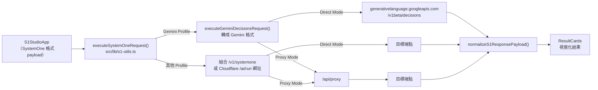

# 系統架構

本文說明 S1 Studio 的整體架構、雙模式建置、請求流程與模組分工。

- **適用版本**：v0.1.19 以後
- **相關文件**：[Proxy 代理協定](proxy.md)、[提供者總覽](providers/README.md)、[請求格式差異](formats/request.md)

## 一句話說明

S1 Studio 是純前端的 Next.js App Router 應用程式。所有設定與紀錄都存在瀏覽器，伺服器端只有兩個無狀態端點：負責轉送請求的 `/api/proxy`，以及不需外部連線的內建模擬器 `/api/mock-systemone/v1/systemone`。

## 雙模式建置

同一份程式碼有兩種執行方式，伺服器端點分別放在兩個目錄。修改其中一邊時，另一邊必須同步修改（見 [AGENTS.md](../AGENTS.md) 第 2 節）。

| 項目 | 本機開發（`make dev`） | Cloudflare Pages 正式環境（`make cf-build`） |
| --- | --- | --- |
| 前端 | Next.js 開發伺服器 | 靜態匯出到 `out/`（`output: 'export'`） |
| `/api/proxy` | [`src/app/api/proxy/route.ts`](../src/app/api/proxy/route.ts)（Route Handler） | [`functions/api/proxy.ts`](../functions/api/proxy.ts)（Pages Function） |
| 模擬器 | [`src/app/api/mock-systemone/v1/systemone/route.ts`](../src/app/api/mock-systemone/v1/systemone/route.ts) | [`functions/api/mock-systemone/v1/systemone.ts`](../functions/api/mock-systemone/v1/systemone.ts) |
| 切換方式 | 預設 | 環境變數 `STATIC_EXPORT=1` 或 `CF_PAGES=1`（見 [`next.config.ts`](../next.config.ts)） |

靜態匯出不能包含 Route Handler，所以 [`scripts/build-cf-pages.sh`](../scripts/build-cf-pages.sh) 會在建置前把 `src/app/api` 暫時搬到 `.cf-api-backup/`，建置結束後由 `trap cleanup EXIT` 搬回來。即使建置失敗也會還原。

> **注意**：因為建置時 `src/app/api` 會暫時消失，任何會被 Next.js 型別檢查到的檔案都不能 import `src/app/api/*`。測試檔因此放在 `tests/`，並由根目錄 `tsconfig.json` 排除，改用 [`tests/tsconfig.json`](../tests/tsconfig.json) 檢查。

## 請求流程

1. 畫面上的 State、圖片與問題組成 `S1RequestPayload`（SystemOne 格式），見 [`src/types/systemone.ts`](../src/types/systemone.ts)。
2. `executeSystemOneRequest()` 依 Profile 決定目標網址、驗證標頭與 Direct／Proxy 模式。
3. Gemini Profile 會在這一步才轉成 Gemini 格式，畫面、範本與歷史紀錄仍維持 SystemOne 格式，細節見 [請求格式差異](formats/request.md)。
4. 回應經 `normalizeS1ResponsePayload()` 統一成同一種結構，細節見 [回應格式差異](formats/response.md)。
5. 結果、延遲與原始回應存成 `ExecutionRunMeta`，並寫入 IndexedDB 歷史紀錄（最多 50 筆）。

## 模組分工

| 檔案 | 職責 |
| --- | --- |
| [`src/types/systemone.ts`](../src/types/systemone.ts) | 請求、回應、Profile、範本與歷史紀錄的型別定義 |
| [`src/lib/s1-utils.ts`](../src/lib/s1-utils.ts) | 提供者判斷、端點組合、模型探索、Local Ollama 診斷、送出請求、回應正規化、問題驗證、雙峰分佈偵測 |
| [`src/lib/gemini-decisions.ts`](../src/lib/gemini-decisions.ts) | Gemini Decisions API 的格式轉換、MIME 判斷、限制檢查與 usage 對應（只依賴型別，不含 React 或 fetch） |
| [`src/lib/code-exporter.ts`](../src/lib/code-exporter.ts) | 產生 cURL、Python、TypeScript 範例程式碼 |
| [`src/lib/presets.ts`](../src/lib/presets.ts) | 內建 Profile、網址範本與場景範本 |
| [`src/lib/profile-link.ts`](../src/lib/profile-link.ts) | 網址 Deep Link 的解析、驗證與匯入計畫 |
| [`src/lib/db.ts`](../src/lib/db.ts) | LocalStorage（Profile）與 IndexedDB（歷史紀錄、自訂範本）存取與舊資料遷移 |
| [`src/components/S1StudioApp.tsx`](../src/components/S1StudioApp.tsx) | 主畫面、執行、A/B 對比、快速鍵 |
| [`src/components/ResultCards.tsx`](../src/components/ResultCards.tsx) | noul／choice／score 結果卡片與門檻值 |
| [`src/components/ProfileManagerModal.tsx`](../src/components/ProfileManagerModal.tsx) | 端點與金鑰設定視窗 |

## 提供者判斷順序

各函式用下列判斷式辨識提供者。Gemini 的判斷一律放在 Cloudflare 與通用邏輯之前，避免落入預設的 `clef` 模型清單。

| 函式 | 判斷條件 |
| --- | --- |
| `isGeminiDecisionsProfile()` | `id === 'gemini-decisions-api'`，或網址主機名稱完全等於 `generativelanguage.googleapis.com` |
| `isCloudflareProfile()` | id 或名稱含 `cloudflare`，或網址含 `/client/v4/accounts/`、`/ai/run/` |
| `isLocalOllamaProfile()` | `id === 'local-ollama-clef'`，或網址含 `localhost:11434`、`127.0.0.1:11434` |
| 內建模擬器 | `id === 's1-builtin-simulator'`，或網址以 `/api/` 開頭 |

Gemini 用主機名稱完全比對而不是子字串比對，所以 `https://evil.example/generativelanguage.googleapis.com` 這類網址不會被誤判（[`tests/gemini-decisions.test.ts`](../tests/gemini-decisions.test.ts) 有測試）。

## 參考資料

- [Next.js：How to create a static export](https://nextjs.org/docs/app/guides/static-exports)（靜態匯出時 Route Handler 只支援 `GET`，這是建置腳本必須移走 `src/app/api` 的原因）
- [Next.js：Route Handlers](https://nextjs.org/docs/app/getting-started/route-handlers)
- [Next.js：route.js API 參考](https://nextjs.org/docs/app/api-reference/file-conventions/route)
- [Cloudflare Pages Functions](https://developers.cloudflare.com/pages/functions/)
- [Cloudflare Pages Functions 路由規則](https://developers.cloudflare.com/pages/functions/routing/)
- [Dexie.js 文件](https://dexie.org/docs/)
- [Mermaid 流程圖語法](https://mermaid.js.org/syntax/flowchart.html)
