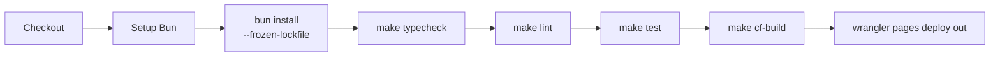

# CI/CD

本文說明 GitHub Actions 工作流程、所需的 Secrets，以及部署到 Cloudflare Pages 的方式。

- **工作流程檔**：[`.github/workflows/deploy-cloudflare-pages.yml`](../.github/workflows/deploy-cloudflare-pages.yml)
- **正式網址**：<https://s1-studio.miniasp.com/>
- **Cloudflare Pages 專案名稱**：`s1-studio`（見 [`wrangler.toml`](../wrangler.toml)）

## 觸發條件

| 事件 | 說明 |
| --- | --- |
| `push` 到 `main` | 執行完整流程並部署正式環境 |
| 對 `main` 發 Pull Request | 執行同樣的檢查；有 Cloudflare Secrets 時也會執行部署步驟 |
| `workflow_dispatch` | 在 GitHub Actions 頁面手動觸發 |

## 流程步驟



| 步驟 | 指令 | 失敗時 |
| --- | --- | --- |
| 安裝相依套件 | `bun install --frozen-lockfile` | `bun.lock` 與 `package.json` 不一致時失敗，請在本機執行 `bun install` 後提交 `bun.lock` |
| 型別檢查 | `make typecheck` | 停止，不部署 |
| 程式碼檢查 | `make lint` | 停止，不部署 |
| 測試 | `make test` | 停止，不部署 |
| 建置 | `make cf-build` | 停止，不部署 |
| 部署 | `cloudflare/wrangler-action@v3` 執行 `pages deploy out --project-name=s1-studio --commit-dirty=true` | 部署失敗 |

任何一個步驟失敗，後面的步驟都不會執行，所以未通過測試的版本不會被部署。

## Secrets

在 GitHub 的 **Settings → Secrets and variables → Actions** 設定：

| Secret | 必要性 | 用途 |
| --- | --- | --- |
| `CLOUDFLARE_API_TOKEN` | 部署必要 | Cloudflare API Token，需要 Cloudflare Pages 的編輯權限 |
| `CLOUDFLARE_ACCOUNT_ID` | 部署必要 | Cloudflare 帳戶 ID |
| `GEMINI_API_KEY` | 選用 | 設定後 CI 會執行真實 Gemini Decisions API 整合測試；未設定時這 3 個測試自動略過 |

用 GitHub CLI 設定：

```bash
gh secret set GEMINI_API_KEY
gh secret set CLOUDFLARE_API_TOKEN
gh secret set CLOUDFLARE_ACCOUNT_ID
```

部署步驟以 `if: ${{ env.CLOUDFLARE_API_TOKEN != '' && env.CLOUDFLARE_ACCOUNT_ID != '' }}` 判斷是否執行。

## 部署產物

- **`out/`**：Next.js 靜態匯出的前端檔案。
- **`functions/`**：Cloudflare Pages 會自動將 `functions/api/proxy.ts` 掛載為 `/api/proxy`，`functions/api/mock-systemone/v1/systemone.ts` 掛載為 `/api/mock-systemone/v1/systemone`（以檔案路徑決定路由）。

## 部署後驗證

```bash
# 1. 確認版本已更新（頁尾顯示 package.json 的版本）
curl -s https://s1-studio.miniasp.com/ | grep -o '0\.1\.[0-9]*' | head -1

# 2. 確認正式環境的 Proxy 能轉送到 Gemini（Bearer 會轉成 x-goog-api-key）
curl -s -X POST https://s1-studio.miniasp.com/api/proxy \
  -H "Authorization: Bearer $GEMINI_API_KEY" \
  -H "x-s1-target-url: https://generativelanguage.googleapis.com/v1beta/decisions" \
  -H "Content-Type: application/json" \
  -d '{"model":"gemini-decision-1","input":"My order arrived broken.","questions":{"q":{"type":"noul","instructions":"Is the item damaged?"}}}'

# 3. 確認內建模擬器
curl -s -X POST https://s1-studio.miniasp.com/api/mock-systemone/v1/systemone \
  -H "Content-Type: application/json" \
  -d '{"state":"refund please","questions":{"q":{"type":"noul","instructions":"refund?"}}}'
```

## 手動部署

```bash
npx wrangler login
make cf-deploy
```

## 已知警告

- **Node.js 20 淘汰**：`actions/checkout@v4` 與 `cloudflare/wrangler-action@v3` 目前以 Node.js 20 執行，GitHub 會強制改用 Node.js 24 並顯示警告，不影響結果。
- **`ubuntu-latest` 遷移**：GitHub 宣布 `ubuntu-latest` 會改為 Ubuntu 26，若之後建置出現差異，可改為固定版本（例如 `ubuntu-24.04`）。

## 參考資料

- [GitHub Docs：Using secrets in GitHub Actions](https://docs.github.com/en/actions/how-tos/write-workflows/choose-what-workflows-do/use-secrets)
- [oven-sh/setup-bun](https://github.com/oven-sh/setup-bun)
- [cloudflare/wrangler-action](https://github.com/cloudflare/wrangler-action)（目前最新主版本為 `@v4`，本專案仍使用 `@v3`）
- [Cloudflare Pages：Use Direct Upload with continuous integration](https://developers.cloudflare.com/pages/how-to/use-direct-upload-with-continuous-integration/)
- [Cloudflare Pages：Direct Upload](https://developers.cloudflare.com/pages/get-started/direct-upload/)
- [Wrangler：Pages 指令](https://developers.cloudflare.com/workers/wrangler/commands/pages/)
- [Cloudflare Pages Functions](https://developers.cloudflare.com/pages/functions/)
- [GitHub CLI：`gh secret set`](https://cli.github.com/manual/gh_secret_set)
